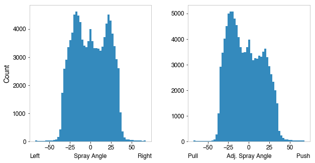

> [!NOTE]
> All public data-fetching APIs are asynchronous. Use `await` inside an async environment, or `asyncio.run()` in scripts.

# Baseball Savant / Statcast

Access Statcast pitch-level queries, leaderboards, park factors, gamefeeds, and local partitioned Parquet datasets via `savant.SavantClient` (`client.savant`).

> [!TIP]
> Need a player's `key_mlbam`? Use `await client.lookup.playerid_lookup("Judge", "Aaron")`.

## Local Partitioned Dataset (`sync_statcast` / `scan_statcast`)

`sync_statcast` scrapes full seasons into `{cache_dir}/compiled-datasets/statcast/year={year}/statcast.parquet`, and `scan_statcast` returns a `pl.LazyFrame` with predicate and projection pushdown.

> [!NOTE]
> `scan_statcast` raises `UpstreamUnavailableError` when a requested season has no local partition and `auto_download=False`. Requires a file-backed cache directory (`BaseballClient(cache_dir=Path)` or default cache).

## Spray Angle Calculation

Calculate spray angles directly with Polars expressions or Python math:

```python
from math import atan2, pi

hc_x, hc_y = 125.42, 198.27
spray_angle = atan2(hc_x - 125.42, 198.27 - hc_y) * 180 / pi
```



## Example

```python
import asyncio
from polars_baseball import BaseballClient


async def main() -> None:
    async with BaseballClient() as client:
        pitches = await client.savant.statcast(start_date="2026-06-01", end_date="2026-06-01")
        expected = await client.savant.expected_stats(2026, player_type="batter", min_pa=100)
        print(pitches.head(2), expected.head(2))


if __name__ == "__main__":
    asyncio.run(main())
```

## Available Methods

`arm_strength`, `base_stealing`, `baserunning_run_value`, `bat_tracking`, `batter`, `batter_percentile_ranks`, `catcher_blocking`, `catcher_framing`, `catcher_poptime`, `catcher_stance`, `catcher_throwing`, `composite_percentile_ranks`, `exitvelo_barrels`, `expected_stats`, `fielding_run_value`, `gamefeed_exit_velocity`, `gamefeed_exit_velocity_many`, `gamefeed_pitch_data`, `gamefeed_pitch_data_many`, `outfield_catch_prob`, `outfield_directional_oaa`, `outfielder_jump`, `outs_above_average`, `park_factors`, `pitch_arsenal_stats`, `pitch_tempo`, `pitcher`, `pitcher_active_spin`, `pitcher_arsenal_stats`, `pitcher_bat_tracking`, `pitcher_exitvelo_barrels`, `pitcher_expected_stats`, `pitcher_percentile_ranks`, `pitcher_pitch_arsenal`, `pitcher_pitch_movement`, `pitcher_run_value`, `pitcher_spin_dir_comp`, `player_percentile_profile`, `run_value`, `running_splits`, `scan_statcast`, `single_game`, `sprint_speed`, `statcast`, `sync_statcast`.

## API Reference

::: polars_baseball.savant.SavantClient
